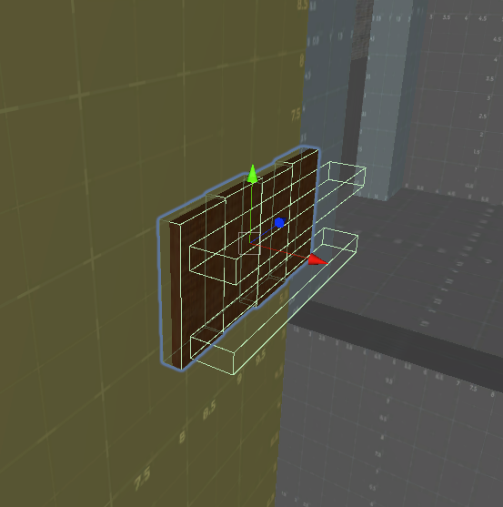
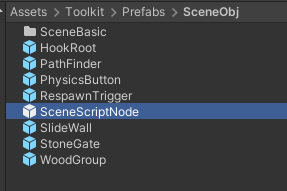
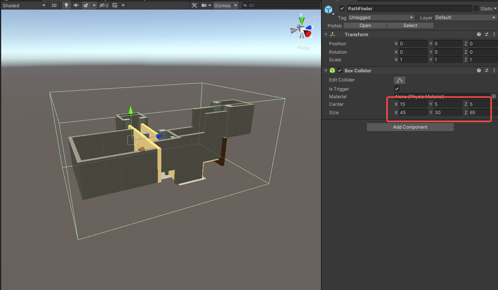
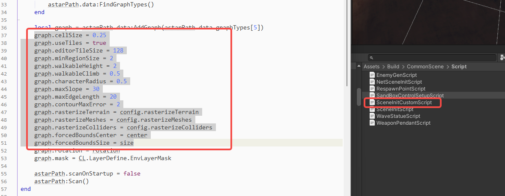
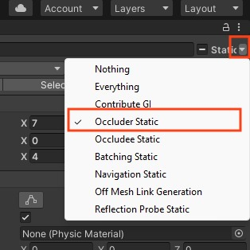
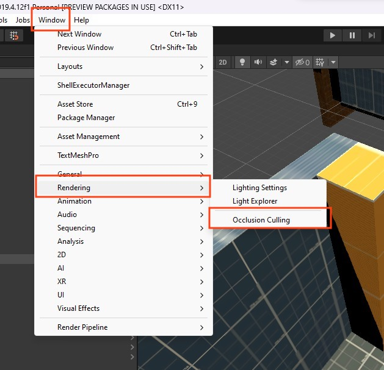
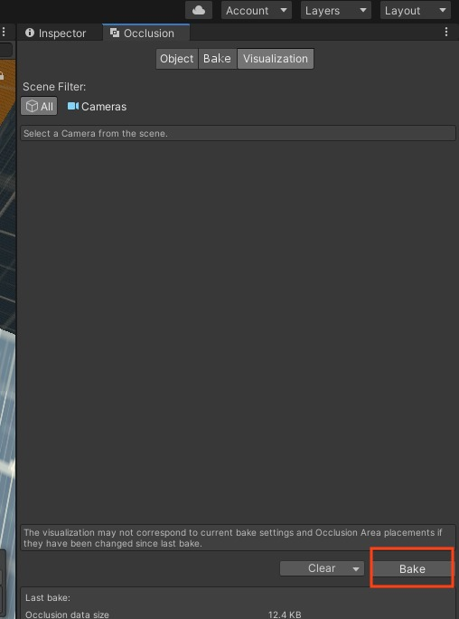
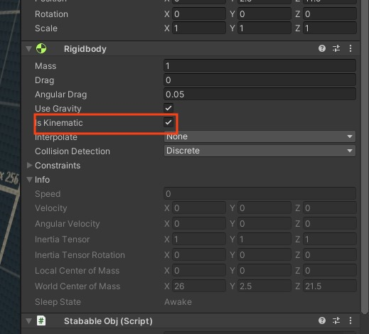
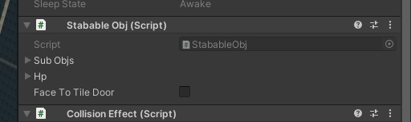

import ModTutorialFragmentPhaseBuild from '/docs/_fragments/_fragment-phase-build.mdx';
import ModTutorialFragmentPhaseTest from '/docs/_fragments/_fragment-phase-test.mdx';
import ModTutorialFragmentStepOpenUnity from '/docs/_fragments/_fragment-step-open-unity.mdx';
import ModTutorialFragmentStepCreateIcon from '/docs/_fragments/_fragment-step-create-icon.mdx';
import ModTutorialFragmentStepTemplateWizard from '/docs/_fragments/_fragment-step-template-wizard.mdx';

Here is a step by step tutorial for making a **scene** mod.

## Phase 1: Define your mod

<ModTutorialFragmentStepOpenUnity />

#### 5. Generate folder structure using the template wizard.

<ModTutorialFragmentStepTemplateWizard modType="Scene" />

#### 6. Place items in the scene

* Open the newly created `scene` file in the `Scene` folder. (for example: `Build > YourNewModFolder > Scene`)
* Add collision to the items by adding `MeshCollider`.
* Make sure to change the layer of the objects to: `CharacterObstacle` or else they will not collide with the player.

**Extra:** There are a couple of prefabs you can use the place special interactable objects.

| Prefab      | Description                                                         |
|-------------|---------------------------------------------------------------------|
| `HookRoot`  | Allows you to add a root that you can swing across gaps.            |
| `SlideWall` | Allows you to add a wall object that you can run along.             |
| `StoneGate` | A togglable gate.                                                   |
| `SkeletonStatue` | A grabbable statue that can start waves.                       |
| `WeaponPendant` | A grabbable weapon that will float in a location until grabbed. |
| `RespawnTrigger` | A collider that will set the respawn point to the center of the collider when a player enters it. |

#### 7. CharacterPos

* Adjust the `CharacterPos` (under `SceneScriptNode`) to adjust the character spawning position.

#### 8. DeadZone

* Adjust the `Transform`'s `Y` value to change the position of the [DeadZone](/docs/details/deadzone-respawntrigger) (under `SceneScriptNode`).
* Place [RespawnTrigger](/docs/details/deadzone-respawntrigger)'s to place respawn points.

#### 9. PathFinder

Resize the `BoxCollider` on `PathFinder` under `SceneScriptNode` so it encloses the walkable area of the scene. The scene initialization script uses these bounds to create the navigation graph.

Save the scene.

##### Preview the navigation graph

1. Open the scene in Unity and stay outside Play mode.

2. Open `Tools > PathFinder Preview`.

   

3. Select `SceneScriptNode > PathFinder` in the Hierarchy, then click **Use Selected Object** in the preview window. Alternatively, drag its scene `BoxCollider` into **Scan Range**. Use the object in the open scene, not a prefab asset.

   

4. Enable **Gizmos** in the Scene view, then click **Generate Preview**. Inspect the displayed navigation surface, outlines, and scan bounds, especially around stairs, slopes, narrow passages, and small platforms.

5. After changing geometry, the scan range, parameters, click **Regenerate Preview**. Geometry changes are not detected automatically, so rescan even if no out-of-date warning appears.

Only geometry on the `CharacterObstacle` layer is collected. If no walkable triangles appear, check the range, layers, collection switches, and overhead clearance. Meshes collected by `rasterizeMeshes` need **Read/Write Enabled** in their import settings; MeshCollider meshes also need to be readable when using `rasterizeColliders`.

##### Adjust navigation parameters

The preview window exposes these settings. Hover a label for more details

**Important: Preview settings are editor-only. To apply adjusted navigation parameters in game, replace `SceneInitScript` with `SceneInitCustomScript`; changing the preview window alone is not enough.**

1. Select `SceneScriptNode`. In its existing `LuaBehaviour` component, change the **Lua Script** identifier from the current prefix plus `SceneInitScript` to the same prefix plus `SceneInitCustomScript`. For example, with the `WMD_` prefix, change `WMD_SceneInitScript` to `WMD_SceneInitCustomScript`. Keep the existing object injections, including `pathFinderNode`, `characterPos`, `deadZone`, and `spawnPointMgr`; do not add a second initialization component.
   
2. Edit customvalue.txt` to match the values tested in the preview. 
   

`CommonScene` scripts are shared. Editing this file affects other scenes that use it; use a separately named copy in your mod's `Script` folder if the settings should apply only to this mod, and point `LuaBehaviour` to that copy's identifier.

The preview is not baked navigation data and is not included in the mod. The game creates its navigation graph during scene initialization; always verify the result in game.

#### 7. Bake the scene
* This optional step can improve performance by preventing rendering of static objects that are fully hidden from the player's view.

  Mark static renderers for occlusion culling:

  - Large, solid objects such as walls, buildings, and terrain should use `Occluder Static`.
  - Static objects that can be hidden, such as decorations, small props, and transparent objects, should use `Occludee Static`.
  - Objects that both hide other geometry and can be hidden should use both flags.

  **Important:** Most static renderers should be marked `Occludee Static`; otherwise, occlusion culling will not remove them when they are hidden. Reserve `Occluder Static` for large, solid geometry that can form effective occlusion.

  Dynamic objects, such as characters and movable props, are not included in the baked occlusion data. Their Renderer `Dynamic Occlusion` setting allows them to be culled at runtime by baked static occluders.

  

* Open the `Occlusion` window by going to `Window > Rendering > Occlusion Culling`.

* In the `Occlusion` window, click the `Bake` button.

* ##### Verify occlusion culling

  1. Select a Camera in the scene and make sure **Occlusion Culling** is enabled in its Inspector.
  2. Open `Window > Rendering > Occlusion Culling` and select the **Visualization** tab.
  3. Add a temporary Camera to the scene, move the Camera in the Scene view and confirm that objects hidden behind occluders disappear from view.
  4. In the Scene view Occlusion Culling pop-up menu, enable **Camera Volumes** (yellow lines) and **Visibility Lines** (green lines) to help inspect the baked visibility data.

  **Note:** Delete the temporary Camera before saving or building the mod, unless it is intentionally part of the scene.

  Save the scene again.

#### Extra - StabableObj
Want some items to be stabbable (and also climbable)? You can do this as followed:

* Find the object you want to be stabbable/climbable.
* Give it a `RigidBody` component and mark it `Is Kinematic`.

* Give it a `StabableObj` component.

#### Extra - Combat Room
* Want to know how to create a **Combat Room**? Please read [Create Combat Room](./create-combat-room).

## Phase 2: Prepare to export your mod

Create Configuration files and fill [(SceneModInfo)](/docs/details/item-info-config)

<ModTutorialFragmentStepCreateIcon modType="Scene" />

## Phase 3: Build the mod

<ModTutorialFragmentPhaseBuild />

## Phase 4: Test & publish the mod

<ModTutorialFragmentPhaseTest />
